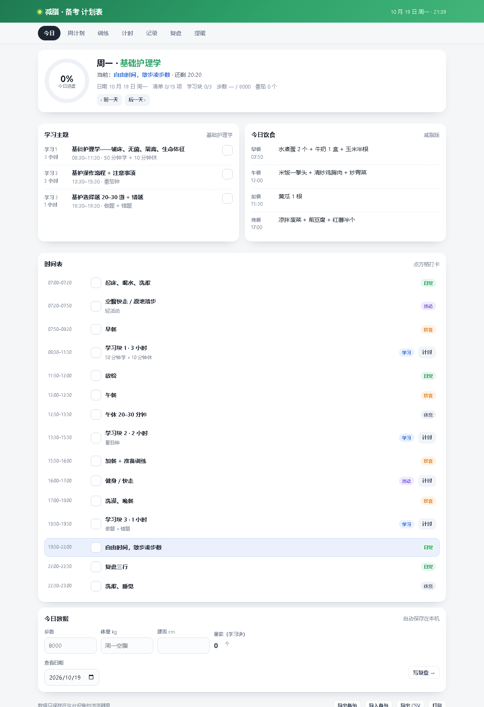

# 减脂 · 备考 计划表（可安装的手机 App）

你那份「每日执行总表（减脂版）」做成了一个 **PWA（可安装的网页 App）**：能加到手机主屏幕、全屏打开、离线可用，数据全部存在本机，并且带 **两层提醒**。

## 线上地址（已部署）

```
https://sxfhdry.github.io/fitplan/
```

手机打开这个地址 → 添加到主屏幕 → 允许通知，就是一个 App。仓库：<https://github.com/sxfhdry/fitplan>，推送到 `main` 会自动重新发布。



## 打开与安装

**本机现在就能用：**

```
http://127.0.0.1:8123/index.html
```

自己启动：

```powershell
python -m http.server 8123 --bind 127.0.0.1 --directory "C:\Users\半白\Documents\deepseek-harness\default-workspace\fitplan"
```

**装到手机：**

| 设备 | 步骤 |
| --- | --- |
| 安卓 | Chrome 打开 → 右上角菜单 →「安装应用」/「添加到主屏幕」 |
| iPhone | Safari 打开 → 底部「分享」→「添加到主屏幕」 |

装好后图标在桌面，点开是全屏、没有浏览器地址栏的样子。

## 七个页面

| 页面 | 用途 |
| --- | --- |
| 今日 | 按星期自动切换当天安排；当前时段高亮 + 倒计时；学习主题、三餐、15 个时间段逐项打卡；步数/体重/腰围/番茄记录 |
| 周计划 | 一周 7 天全景（学习三块 + 三餐 + 训练 + 步数 + 完成率），可前后翻周 |
| 训练 | 8 个动作 × 4 轮逐格打卡、热身/有氧/拉伸环节、60/90 秒组间休息计时；快走日、轻活动日、休息日自动换内容 |
| 计时 | 学习 50/10、番茄 25/5、小块 15/5，结束响铃并累计番茄 |
| 记录 | 体重趋势曲线、最近 30 天打卡表、累计统计 |
| 复盘 | 三行复盘自动保存 + 最近 7 天完成率 |
| 提醒 | 通知权限、15 个时间点逐个开关、导出日历提醒、安装入口 |

## 提醒怎么工作（重点）

**第一层：浏览器通知**（`提醒` 页 → 开启通知）

- 到点用系统通知栏弹出，内容会带上当天的学习主题、三餐或训练内容。
- 时间是固定骨架：07:00 起床、08:30 学习块 1、13:30 学习块 2、16:00 训练、18:30 学习块 3、22:00 复盘……每个都能单独关掉。
- 限制：**页面开着（或刚切到后台）才会响**；手机锁屏、浏览器被彻底关闭后不会响。
- 限制：浏览器只允许 **HTTPS 或 localhost** 的网页发通知。所以电脑上用 `127.0.0.1` 没问题；手机用局域网 `http://电脑IP:8123` 打开时，只能打卡、收不到通知。

**第二层：系统日历闹钟**（`提醒` 页 → 导出 .ics）推荐

- 把 15 个时间点导出成每天重复的日历事件，带闹钟（`VALARM`），由手机自带日历负责响铃 —— **不打开这个页面也会响，锁屏也响**。
- iPhone：Safari 打开本页 → 导出 → 点「加入日历」。
- 安卓：导出后点通知，用「日历」应用导入。
- 电脑：双击 `.ics` 导入 Outlook 或系统日历。
- 事件内容是按你当前打开的提醒项生成的：关掉某一项再导出，就不会包含它。

**想做到「真 App + 后台推送」**，两条路：

1. 把 `fitplan/` 发布到任意 HTTPS 静态托管（GitHub Pages、Cloudflare Pages、Vercel），手机打开后安装 PWA，通知在系统里就是一等公民（iOS 16.4+ 需要先安装到主屏幕）。**部署包和步骤已经准备好了，见 [DEPLOY.md](DEPLOY.md)**，其中方案 A 全程不用装任何软件。
2. 打真正的安卓 APK：这台机器没有 Android SDK / Gradle / Android Studio，需要先装（约几个 GB），之后可以用 Capacitor 把现有页面直接包成 APK 并接原生 AlarmManager。

## 数据怎么存

- 存在浏览器 `localStorage`（键 `fitplan.v1`），一天一条，按日期翻看、补记都行。
- 提醒开关、已提醒过的记录也一起存，导出的备份里包含这些设置。
- 换设备前用底部「导出备份」，新设备「导入备份」。清缓存/换浏览器会丢数据，记得备份。

## 想改计划内容

`app.js` 开头三个数组就是全部内容，改文字即可：

- `SLOTS`：固定时间骨架（时间、标题、备注、类型）——提醒时间也来自这里
- `DAYS`：周一到周日（学习三块、三餐、训练、步数目标、加做事项）
- `CIRCUIT` / `ROUNDS` / `PHASES`：循环训练动作、轮次、环节

改完刷新页面生效，已打的卡不受影响。

## 文件结构

```
fitplan/
├── index.html           页面骨架、标签栏、PWA 元信息
├── styles.css           样式（含手机窄屏、打印）
├── app.js               数据、渲染、打卡、计时器、图表、提醒、ICS、导入导出
├── manifest.json        安装配置（名称、图标、全屏）
├── sw.js                Service Worker：离线缓存 + 通知点击
├── icon-192.png / icon-512.png / icon-180.png   应用图标
├── .github/workflows/pages.yml  推送到 main 自动发布 GitHub Pages
├── deploy.ps1           一键部署脚本（需 git + gh）
├── DEPLOY.md            三种 HTTPS 部署方案（含零安装方案）
├── .nojekyll            GitHub Pages 用
├── preview-desktop.png  桌面端预览
├── preview-mobile.png   手机端预览
├── preview-reminder.png 提醒页预览
└── README.md
```

## 已知边界

- 通知不是推送：没有服务器，所以不能在关掉浏览器后主动弹通知（日历提醒补上这一段）。
- iOS Safari 不支持页面内直接弹通知，iPhone 上请用日历提醒，或部署 HTTPS 后安装 PWA（iOS 16.4+）。
- 多设备之间不同步，需要手动导入导出。
- `file://` 直接双击打开时，Service Worker 和通知都不可用，只能当普通网页用；请用本地服务器打开。
